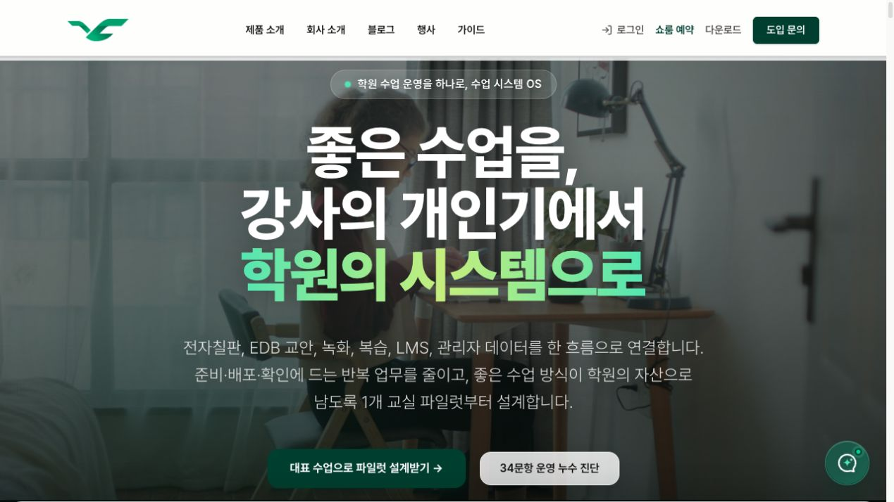
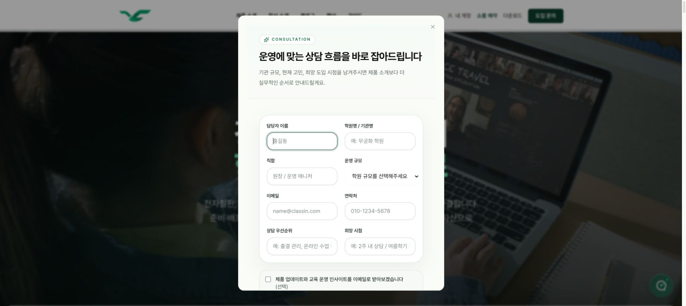
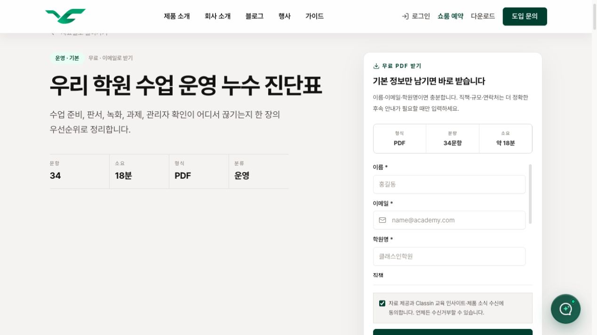
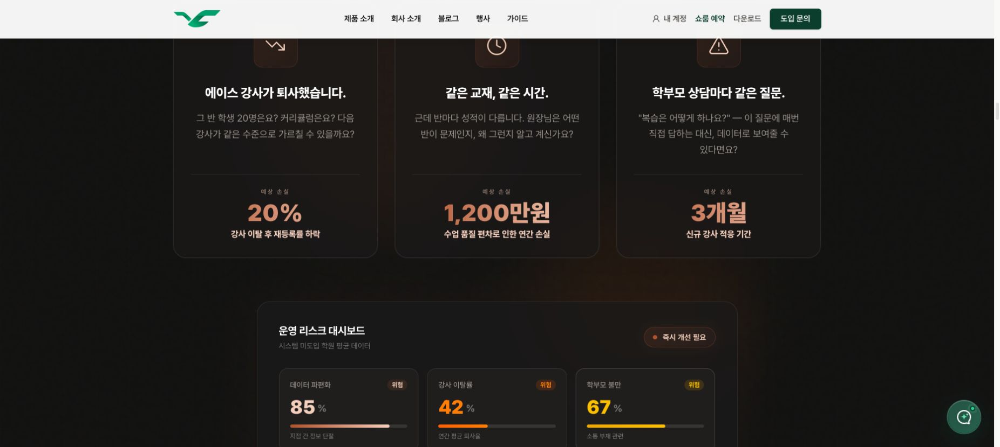
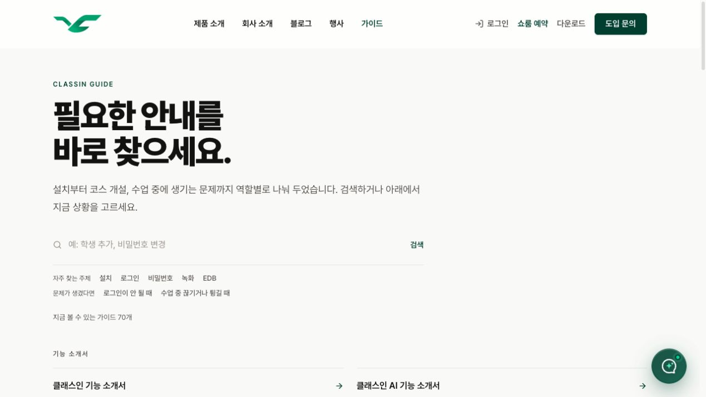

# Classin 공개 홈페이지: 고객 단계·확산 관점 감사와 디벨롭 기획

기준일: 2026-10-28  
상태: **검토용 제안**. 현재 운영 기준이나 구현 지시를 새로 확정하는 문서가 아니다.  
범위: 공개 홈페이지와 연결된 자료실·가이드·제품·FAQ·행사·다운로드. 실제 화면 확인, 공개 자료, 저장소의 현재 코드와 기준 문서를 대조했다. 세 명의 서브에이전트가 신규 유입, 고객·업셀, 티핑포인트 관점을 나눠 살폈다.

기존 [공개 사이트 전수 점검·디벨롭 기획](../active/public-site-audit-motion-plan-2026-10-26.md)의 기술·디자인 이슈를 대체하지 않는다. 아래는 **어떤 사람이 무엇을 얻고 왜 다시 오거나 다른 사람에게 알려줄지**를 중심으로 덧붙인 평가다. 제안 일정과 점수는 판단을 돕는 가설이며 실제 전환율이나 고객 만족도 측정값이 아니다.

## 1. 결론

**홈페이지는 Classin을 설명하는 데 많은 노력을 기울이지만, 방문자가 자기 상황을 이해하고 실제로 결정하거나 실행하도록 돕는 경험은 그보다 약하다.** 자료가 부족한 것은 아니다. 이미 자료실 13종, 역할별 가이드, 사례, FAQ, 제품 업데이트, 쇼룸 예약, 블로그 공유 기능이 있다. 다만 이 자산이 누구에게 어떤 순서로 도움이 되는지 바로 보이지 않고, 중요한 일부 수치·상품 조건의 근거가 분명하지 않다.

가장 가혹하게 말하면 **지금의 사이트는 “우리가 이렇게 좋은 제품이다”를 많이 말하지만, 방문자가 “이 자료는 내일도 다시 찾아볼 가치가 있다”고 느낄 만한 이유는 충분히 앞에 내놓지 못한다.** 특히 추천자는 자기 신뢰를 걸고 전달해야 하는데, 연구 인용과 제품 범위에서 의문이 생기면 추천을 멈출 이유가 생긴다.

순서는 ① 신뢰와 작동성 복구 → ② 기존 자료를 3가지 고객 상황으로 재배치 → ③ 실제 수업·사례·결정 자료 강화 → ④ 고객의 실행과 자발적인 추천 지원이다. 더 많은 PDF나 AI 기능 소개를 바로 추가하는 일은 우선순위가 낮다.

## 2. 이번에 본 실제 화면

### 1) 홈페이지 첫 화면: 문제와 파일럿은 선명하다

강사 개인기 의존을 학원 운영의 문제로 제시하고, 한 교실 파일럿과 34문항 진단을 연결한다. 반면 배경 영상만으로는 제품이 실제 수업에서 무엇을 바꾸는지 바로 보이지 않으며, EDB·LMS는 처음 방문한 사람에게 낯설 수 있다. 출처: [홈페이지](https://classin.co.kr/).

### 2) 파일럿 상담: 관심 다음에 바로 긴 폼이 나온다

담당자·기관·직함·규모·이메일·연락처·상담 우선순위·시점 입력란이 보인다. 모든 항목이 필수라는 뜻은 아니다. 다만 첫 화면에서 필수 여부와 신청 후 받을 결과가 충분히 빠르게 드러나지 않고 제출 버튼도 화면 아래에 있다. 방문자의 부담이나 실제 이탈률은 사용성 테스트로 확인해야 한다.

### 3) 진단: 내용은 공개돼 있지만 중립성과 동선이 아쉽다

[34문항과 해석·7일 계획](https://classin.co.kr/resources/academy-system-checklist)은 웹에서 읽을 수 있다. PDF를 받는 양식에는 이름·이메일·학원명이 필요하고, 자료 제공과 제품 소식 수신을 함께 묻는 체크박스가 기본 선택돼 있다. 문항 중에는 **EDB 파일·50페이지 칠판 사용 여부**가 포함돼 제품과 무관한 운영 진단처럼 받아들이기 어렵다. 진단을 없애기보다 운영 문제와 제품 기능 점검을 분리해야 한다.

### 4) 위험 수치: 강한 주장에 출처와 조건이 보이지 않는다

강사 이탈, 연간 손실, 지점 간 정보 단절 등을 숫자로 제시하지만 확인한 화면에서 출처·표본·기간·산식은 찾지 못했다. **거짓이라는 판정이 아니라 검증 가능한 근거를 제공하지 못한 상태**다. 이런 숫자는 구매 결정을 돕기보다 판매자의 과장을 의심하게 만들 수 있다.

### 5) 가이드: 고객에게 도움이 되는 기반이 이미 있다

[가이드](https://classin.co.kr/docs)는 검색, 설치·로그인·녹화 주제, 관리자·교사·학생별 자료, 문제 해결 경로를 제공한다. 고객용 콘텐츠가 없다고 평가해서는 안 된다. 문제는 홈페이지에서 이미 사용 중인 사람에게 **지금 할 일과 다음 단계**를 안내하는 힘이 약하다는 점이다.

## 3. 고객 단계별 가혹한 평가

점수는 이번 화면 감사자의 **정성 판단**이다. 5는 별도 상담 없이 자기 상황을 이해하고 바로 행동할 수 있는 상태, 3은 유용한 자산은 있지만 찾기·해석·신뢰에 마찰이 있는 상태, 1은 신뢰 또는 다음 행동에 큰 장애가 있는 상태를 뜻한다. 방문자 데이터나 인터뷰로 보정하지 않았다.

| 대상 | 점수 | 지금 얻을 수 있는 것 | 가혹한 평가 | 가장 필요한 다음 경험 |
| --- | --- | --- | --- | --- |
| 리드: 문제는 있지만 Classin은 낯선 사람 | 3/5 | 학원 운영 문제 제기, 진단, 소개와 사례 | “수업 시스템 OS”라는 말은 기억되지만 자기 수업이 어떻게 달라지는지는 보드·화면을 보기 전까지 상상해야 한다. 긴 34문항은 흥미를 느끼기도 전에 숙제처럼 보일 수 있다. | **3분 운영 점검 + 실제 수업 60초**. 연락처를 내기 전 바로 쓸 수 있는 결과와 관련 가이드 한 개를 제공한다. |
| 유효 리드: 기관·역할·문제가 맞고 대화 의사가 있는 사람 | 3/5 | 파일럿 상담, 자료실, 쇼룸 | 관심의 강도를 구별할 기회는 있지만 진단 다운로드만으로 도입 의향을 단정할 수 없다. 폼은 입력의 이유와 상담 후 받는 것을 더 명확히 해야 한다. | 대표 수업 하나를 기준으로 **준비물·소요 시간·상담 후 결과물**을 보여주고 필요한 연락 수단만 받는다. |
| 도입을 고민하는 예비 고객 | 2/5 | [FAQ](https://classin.co.kr/faq), 비교 자료, 22질문, 쇼룸 | “우리 학원에 필요한 구성과 비용 범위, 데이터를 누가 어떻게 다루는가”라는 결정 질문에 공개 화면만으로 확신을 얻기 어렵다. 추상적 보안 표현과 조건이 다른 제품 설명이 함께 보인다. | **도입 판단 한 장**: 구성 항목, 가능한 것, 별도 연동, 아직 확인할 것, 담당자에게 물을 질문. |
| 기존 고객 | 3/5 | 가이드·검색·업데이트·기술지원 문의 | 자료는 있으나 홈의 주된 메시지는 다시 신규 도입을 권한다. 이미 쓰는 원장이나 강사가 “오늘 내 문제를 해결하거나 더 잘 쓰려면?”에 바로 들어갈 별도 입구가 약하다. | **이미 사용 중이신가요?** → 첫 수업 / 문제 해결 / 더 잘 활용하기. 기존 가이드를 일의 순서로 묶는다. |
| 업셀 후보 | 2/5 | 하드웨어·소프트웨어 소개, 업데이트, 사례 | 추가 장비가 필요한 조건과 기존 장비로 가능한 범위를 충분히 이해하기 전 상품을 비교해야 한다. 요금제·AI 기능 조건이 화면마다 달라지면 추가 구매를 권하기 어렵다. | **현재 사용 → 목표 → 기존 환경으로 가능한 것 → 추가 구성이 필요한 조건 → 비용·상담** 순서의 안내. |

운영 정의 제안: “유효 리드”는 다운로드 점수 하나가 아니라 **기관 적합성, 해결할 실제 문제, 연락 가능 여부와 당사자의 상담 의사**를 확인한 상태다. 예산·시점은 확인되면 유용하지만 미상일 수 있다. 고객이나 강사의 자료 열람을 구매 의향으로 자동 간주하지 않는다.

## 4. 티핑포인트: 추천할 사람에게 무엇이 필요한가

커넥터·메이븐·세일즈맨은 사람을 고정 분류하거나 과학적으로 검증된 예측 모델처럼 다루지 않는다. 한 사람이 여러 역할을 할 수 있고 고객 단계와도 별개다. 아래 인물상은 **콘텐츠 설계 가설**이다.

| 역할 | Classin 현장에서의 가설 | 점수 | 현재와 문제 | 주고 싶은 가치 |
| --- | --- | --- | --- | --- |
| 커넥터 | 다른 학원 원장, 지역 모임 주최자, 교육 업계 관계자를 연결하는 사람 | 2/5 | 홈 후기에는 주변에 알리고 싶다는 사용자가 있고, [블로그](https://classin.co.kr/blog)는 링크 복사를 지원한다. 그러나 누구에게 왜 보내면 좋을지와 짧은 설명은 부족하다. [행사](https://classin.co.kr/events)는 확인 시 진행·예정이 각각 0건이었다. | “결석 보강 때문에 고민하는 원장에게 보내는 1분 사례”처럼 **수신자의 문제부터 설명하는 카드**와 자유롭게 고쳐 쓸 전달 문구. 차기 모임이 실제로 정해지면 후기·자료와 연결. |
| 메이븐 | 교육 방식과 도구의 정확성을 따지는 교사·원장·에듀테크 전문가 | 1/5 | 자료는 많지만 홈페이지의 연구 인용에 구체적인 오류가 있고, 비교 워크시트에는 내부 마케팅 이벤트·픽셀 관련 문항이 섞여 있다. 꼼꼼하게 읽을수록 불신이 생길 수 있다. | **출처·적용 조건·기능 한계·최종 확인일·실제 화면**이 있는 비교 및 검증 카드. 반대 사례와 모르는 부분도 공개. |
| 세일즈맨 | 동료 원장이나 내부 의사결정자의 행동을 설득하는 열정적인 사용자·강사·담당자 | 2/5 | 후기와 비교표는 있지만 다른 의사결정자에게 전달할 문제·대안·비용·범위·제약·다음 단계가 한 장에 모여 있지 않다. | 실제 사례의 **상황 → 시도 → 결과 → 한계**, 도입 범위와 90일 파일럿을 한 장에 담은 설득 자료. 해당 고객의 자발적 추천을 돕는다. |

기존 [비교 워크시트](https://classin.co.kr/resources/academy-software-selection-worksheet)는 많은 문항을 공개하고 연동 경계도 설명한다. 다만 고객 의사결정에 관계없는 내부 이벤트 추적·픽셀 운영 문항은 고객용 체크리스트에서 제거할 후보로 확인한다. **공유 버튼을 새로 만드는 것보다 공유할 가치와 설명을 만드는 일이 먼저다.**

## 5. 신뢰를 훼손하는 구체 사례: 우선 바로잡을 것

### 5-1. 교육 연구 인용 오류

[홈페이지](https://classin.co.kr/)는 능동 학습의 성취도가 1.5배 높고 낙제율이 55% 감소했다고 서술한다. [Freeman 등의 원논문](https://pmc.ncbi.nlm.nih.gov/articles/PMC4060654/)은 대학 STEM 수업 연구들을 종합해 **전통 강의에서 낙제 위험이 능동 학습보다 약 1.5배, 즉 55% 높았다**고 보고한다. 성취도 1.5배와 낙제율 55% 감소라는 뜻이 아니다. 대학 STEM 맥락의 연구가 Classin 제품 자체의 효과를 입증한 것도 아니다.

홈의 에빙하우스 수치 역시 무의미 음절을 대상으로 한 재학습 절약량을 모든 수업의 기억 손실률처럼 이해하게 할 수 있다. [재현 연구](https://journals.plos.org/plosone/article?id=10.1371/journal.pone.0120644)의 실험 조건을 명시하거나 수치를 제거한다. 수업 직후 AI 요약 퀴즈가 자동 전송된다는 제품 설명도 현재 제공 조건을 별도로 확인해야 한다.

**조치:** 인용의 방향·대상·측정 지표를 원문과 대조하고, Classin의 효과는 별도 자료가 없으면 연결하지 않는다. 확인 전에는 문제 문장을 노출하지 않는다.

### 5-2. 추정치와 실제 효과를 구분하지 않는다

홈의 학원 손실 지표, 강사 1인당 주 15시간 절감, 예시 대시보드 수치에는 화면에서 확인할 수 있는 출처와 산식이 없다. 70% 단축은 목표로 제시돼 있지만 실측 성과와 한 화면에서 혼동될 수 있다. 수치가 맞고 틀림은 아직 판정할 수 없다.

**조치:** 원자료·기간·대상·산식을 확인해 공개할 수 있는 수치만 사용한다. 검증 불가 수치는 삭제하거나 근거가 없는 예상 절감률을 제시하지 않는 질문형 설명으로 바꾼다. 목업은 “예시 화면”으로 밝힌다. 실제 사례의 숫자는 해당 고객의 공개 동의와 측정 조건을 확인한다.

### 5-3. 제품·요금·버전의 설명이 서로 어긋난다

- [소프트웨어 페이지](https://classin.co.kr/product/sw)는 AI 기능의 기본 포함을 강조한다. 반면 [6.0.9 가이드](https://classin.co.kr/docs/updates/classin-ai-blackboard-609)는 AI 칠판의 별도 활성화와 버전 조건을, [업데이트 안내](https://classin.co.kr/docs/updates/classin-609-update)는 실시간 번역의 별도 과금·요금제 제한을 설명한다. AI 기능마다 포함·활성화·요금·기기 조건이 무엇인지 확인이 필요하다.
- [다운로드](https://classin.co.kr/download)는 6.0.8로 표시되지만 [업데이트](https://classin.co.kr/updates)는 6.0.9를 소개한다. 설치 후 자동 업데이트 여부와 공식 배포 경로는 이번에 검증하지 않았다.
- 제품 페이지의 Standard·Plus·Enterprise와 [요금제 가이드](https://classin.co.kr/docs/software/software-pricing-quote-bundle-faq)의 Pro·Business·Enterprise 관계가 명확하지 않다. 실제 계약·판매 정책을 확인하기 전 어느 한쪽을 정답으로 단정하지 않는다.
- 정율사관 사례의 온보딩은 제품 페이지에 50% 단축과 3주→3일이 함께 표시된다. **같은 기간·같은 지표라면** 서로 맞지 않으므로 측정 정의와 원자료를 확인한다.

**조치:** 제품·CS·영업이 기능별 `사용 가능 버전 / 대상 계정·권한 / 별도 활성화 / 과금·한도 / 판매 여부 / 확인일`을 한 번 검증하고 홈·제품·FAQ·가이드에서 같은 정보를 참조한다. 확인되지 않은 항목은 “확인 중”으로 둔다.

### 5-4. 기존 기술 감사의 P0도 함께 재확인

2026-10-26 [기존 감사](../active/public-site-audit-motion-plan-2026-10-26.md)는 캠페인 랜딩 상담 거절, 모바일 하단 CTA 가림, 자료 다운로드 동의와 추적 문제 등을 운영 재현 또는 코드 확인으로 기록했다. **이번 고객 관점 감사에서 그 전체를 재현하지 않았다.** 새 콘텐츠나 광고 확대 전에 현재 운영에서 다시 확인하고, 여전히 유효하다면 기존 W0에 따라 고친다. 실제 고객 정보가 들어가는 테스트 제출은 하지 않았다.

## 6. 디벨롭 콘셉트: “학원 수업을 위한 실용 허브”

사이트 전체를 세 가지 질문으로 정리한다. 이는 방문자를 영구 분류하는 기능이 아니라 **스스로 고르는 안내 경로**다.

1. **처음 알아보는 중** — 우리 학원에서 어떤 일이 달라지는지, 먼저 확인할 문제가 무엇인지.
2. **도입을 검토하는 중** — 어떤 구성과 조건이 필요한지, 쇼룸·파일럿에서 무엇을 확인할지.
3. **이미 사용 중** — 첫 수업, 막힌 문제, 역할별 활용, 다음 단계가 무엇인지.

세 경로의 공통 규칙은 `문제 한 가지 → 지금 얻는 결과 → 근거와 한계 → 원할 때 다음 행동`이다. 유효 리드나 업셀 후보라는 표현은 고객에게 드러내지 않는다. 한 사람은 언제든 다른 경로로 전환할 수 있다.

### 홈 구성 제안

| 위치 | 제안 | 바로 연결할 기존 자산 |
| --- | --- | --- |
| 첫 화면 | 지금의 학원 운영 메시지를 유지하되, 실제 수업 장면과 낯선 용어 설명을 덧붙인다. 메인 CTA는 상담, 보조 CTA는 실제 수업 보기. | 파일럿 상담·쇼룸, 제품 화면 |
| 첫 화면 바로 아래 | “처음 알아보기 / 도입 검토하기 / 이미 사용 중” 3개 진입 링크. 모바일에서 버튼과 챗봇이 겹치지 않게 검증. | 자료실·FAQ·가이드 |
| 문제 발견 | 제품 중립적인 3문항. 결과에서 당장 할 일 1개와 관련된 상세 자료를 보여준다. | 34문항 진단의 운영 문제·7일 플랜을 재구성 |
| 실제 수업 | `수업 전 교안 → 판서 → 녹화·복습 → 운영 확인` 중 한 교실의 실제 흐름을 조건과 함께 보여준다. | 기존 제품 가이드와 검증된 실제 녹화 |
| 판단과 증거 | 실제 사례 1~2개, 구성 요소·한계, 원문이 있는 비교 및 연구. | 블로그 사례, FAQ, 22질문, 쇼룸 키트 |
| 고객용 영역 | “오늘 어떤 일을 하시나요?” 아래 첫 수업·문제 해결·활용 확장. | 역할별 가이드·업데이트·기술지원 |
| 공유 | 사례별 1분 요약과 대상별 전달 문구. 링크 복사는 기존 기능 재사용. | 블로그 공유·포럼 후기 |

예시 카피: “판서와 수업 기록을 한 번 남기고, 필요한 사람과 다시 쓰는 흐름을 살펴보세요.” 실제 제공 범위와 사용 조건을 검증한 뒤 적용한다. “무조건 시간을 줄여준다”, “모든 기능이 기본 제공된다”는 문구는 쓰지 않는다.

## 7. 우선 제작할 경험 6가지

### A. 3분 운영 점검 — 첫 방문자가 즉시 가져갈 것

**대상:** 처음 온 원장·실장. **목표:** 개인정보를 주기 전 자기 문제 하나를 정리한다.

1. “결석한 학생에게 복습 자료를 전달할 책임과 순서가 정해져 있나요?”
2. “다른 강사가 대표 수업의 자료와 판서를 찾아 다시 쓸 수 있나요?”
3. “원장이나 실장이 수업 후 확인할 항목과 담당자가 정해져 있나요?”

각 문항은 `정해져 있다 / 불편하다 / 잘 모르겠다`로 답한다. 결과는 고객을 등급화하지 않고 선택한 문제마다 **현장 행동 1개 + 기존 가이드 또는 체크리스트**를 보여준다. 예: 복습 전달이 불편하면 “최근 결석 1건을 골라 담당자·자료 위치·발송 시점을 적어보세요”와 관련 가이드. 34문항은 상세 점검으로 연결하되 제품 기능 사용 여부는 별도 섹션에 둔다.

**완료 기준:** 연락처 없이 3문항과 결과를 볼 수 있고, 각 결과에 설명·한계·관련 기존 자료 1개가 있다. PDF 요청과 마케팅 수신은 별도로 선택한다. 점수만으로 상담 의향을 추론하지 않는다.

### B. 60초 실제 수업 — 제품을 보여주는 증거

**대상:** 첫 방문자·관심 있는 원장·실장. **목표:** 한 교실이 실제로 어떻게 돌아가는지 이해한다.

- 0~15초: 교안이나 판서를 불러오는 실제 화면.
- 15~35초: 수업 장면과 판서 저장.
- 35~50초: 녹화·복습 자료 확인.
- 50~60초: 관리자가 확인할 수 있는 범위와 데모·가이드 링크.

화면마다 “어느 계정·버전·설정에서 가능한가”를 표시하고, 학생·수업 자료의 공개 권리를 확인한다. 실제 제품 시연은 실제 화면 녹화와 간단한 편집으로 만든다. 연출용 도입 장면은 일반 편집 도구 또는 사용자의 기존 Google 계정으로 **Google Flow**를 이용하는 방법도 선택할 수 있다. 생성한 장면을 제품의 실제 작동 화면으로 제시하지 않는다.

**완료 기준:** 소리 없이 자막만으로 흐름과 사용 조건을 이해할 수 있고, 모바일에서도 재생·정지가 가능하다. 동영상 재생 수는 구매 의도가 아니라 관심 지표다.

### C. 도입 판단 한 장 — 고민 중인 사람과 설득자를 위해

**대상:** 원장, 실장, 함께 결정하는 강사·운영 책임자. **목표:** 회의에서 필요한 질문을 빠짐없이 꺼낸다.

| 항목 | 한 장에 들어갈 내용 |
| --- | --- |
| 우리 학원의 문제 | 예: 결석 보강 자료 전달이 담당자마다 다름 |
| 첫 검증 범위 | 대표 수업 1개, 참여 역할, 시작·종료 시점 |
| 구성 요소 | 보드·OPS·카메라/마이크·SW·설치·온보딩·스토리지·갱신 중 필요한 것과 제외한 것 |
| 비교 질문 | 현재 도구로 가능한 것, Classin에서 확인할 것, 별도 연동할 것 |
| 데이터·권한 | 누가 접근·내보내기·퇴사 후 권한 회수를 관리하는지, 답변이 확인되지 않은 항목 |
| 성공 기준 | 고객이 직접 정한 실행 여부와 전후 시간 기록. 보장 수치 아님 |
| 다음 행동 | 쇼룸에서 볼 장면, 담당자, 확인이 필요한 질문 |

FAQ와 22질문, 쇼룸 키트와 90일 로드맵을 재사용한다. 가격과 서버 위치 등 확인되지 않은 값은 빈칸 또는 “확인 필요”로 둔다. 상담 전에 인쇄·공유할 수 있게 한다.

### D. 첫 7일 고객 실행 경로 — 기존 고객이 다시 찾을 이유

**대상:** 도입 직후 관리자와 교사. **목표:** 첫 수업과 녹화·복습 확인까지 스스로 완료한다.

| 시점 | 관리자 | 강사 | 기존 링크 예시 |
| --- | --- | --- | --- |
| 1일 | 계정·권한 확인 | 앱 버전과 로그인 확인 | 설치·기관 설정 가이드 |
| 2~3일 | 강사·학생과 코스 준비 | 대표 교안 준비 | 교사 추가·코스 개설·EDB 안내 |
| 4~5일 | 수업 확인 담당자 지정 | 첫 수업 진행 | 수업 시작·판서 가이드 |
| 6~7일 | 녹화·접근 권한 확인 | 복습 자료 1건 확인 | 녹화·다시보기·문제 해결 |

각 단계에는 `예상 소요 / 필요한 권한·버전 / 완료를 직접 확인하는 방법 / 막히면 도움받기`를 둔다. 체크는 초기에는 사용자 스스로 표시하는 기능으로 충분하다. Classin 제품 사용 이력이나 계약 정보가 웹 계정에 연동돼 있다고 가정하지 않는다.

**완료 기준:** 초보 교사·관리자 각각 한 명이 관련 가이드를 찾아 첫 수업과 복습 확인 순서를 설명할 수 있다. 실제 고객의 첫 수업 완료는 제품 데이터 연동이 검증되기 전까지 자기 보고로 표기한다.

### E. 기존 환경에서 다음 단계 찾기 — 무리 없는 업셀

**대상:** 이미 쓰고 있지만 더 나은 수업 환경이 필요한 사람. **목표:** 추가 구매가 필요한지 먼저 판단한다.

선택: `현재 보드/PC·SW 사용 여부 → 바꾸려는 문제(녹화/교안/원격 참여/관리) → 필요한 교실 수`. 결과는 다음 3갈래로 제시한다.

1. **기존 구성으로 먼저 해볼 것:** 권한·버전·설정 확인과 관련 가이드.
2. **추가 구성 검토:** 실제 제품 정책상 필요한 장비·요금제·설치 조건이 확인된 경우에만 표시.
3. **상담 확인:** 네트워크·벽체·카메라·기존 계약 등 원격으로 확정할 수 없는 항목.

추가 구매를 권하지 않는 결과도 정상 결과다. 실제 상품과 가격, 연동 범위가 정리되기 전에는 추천 알고리즘을 만들지 않는다. 행사·업데이트에서 실행 가능한 활용 팁을 연결해 재방문을 돕는다.

### F. 추천 가능한 실제 사례 — 커넥터·메이븐·세일즈맨을 함께 돕기

우선 동의받은 사례 1~2개를 아래 공통 양식으로 정리한다. 숫자가 없으면 빈칸으로 두고, 실제 관찰과 담당자의 의견을 구분한다.

`학원 유형·상황 → 기존 방식의 어려움 → 선택한 구성과 기간 → 실제로 바뀐 행동 → 확인된 결과와 측정 방식 → 여전히 남은 한계 → 같은 문제를 가진 사람에게 해볼 첫 단계`.

같은 내용을 세 가지 길이로 만든다: **30초 소개 / 한 장 요약 / 출처와 조건을 포함한 상세 사례**. 전달 문구 예: “결석 학생에게 복습 자료 보내는 과정이 고민이라면, 이 학원은 담당자와 자료 위치를 이렇게 정리했다고 해요.” 사용자에게 자유롭게 수정하도록 두고, 수신자의 연락처를 입력받지 않는다. 기존 링크 복사 버튼을 활용하며 사례 공개 동의·기간을 확인한다.

## 8. 운영과 측정: 기대 효과를 실제로 판별하기

### 8-1. 기존 계측부터 확인

코드에는 CTA 클릭, 자료 조회·다운로드, 블로그 공유, 가이드 검색·피드백 이벤트가 있다([분석 코드](../../lib/analytics.ts), [이벤트 수집](../../app/api/track/event/route.ts), [가이드 검색](../../components/docs/DocsSearchLogger.tsx)). **코드의 존재는 운영에서 정상 수집되고 동의 조건을 지킨다는 증거가 아니다.** 먼저 실제 저장 여부·중복·경로·동의 상태와 CRM 대응 범위를 점검한다.

기준 기간과 이후 비교 기간을 같은 요일·유입 채널 기준으로 잡고, 트래픽과 행사·광고 변경을 함께 기록한다. 표본이 적으면 추세와 정성 의견을 보고 확정적 통계를 주장하지 않는다. 개인정보와 학생·학습 데이터를 마케팅 이벤트에 넣지 않는다.

| 질문 | 지표와 분모 | 해석 주의 |
| --- | --- | --- |
| 방문자가 가치를 얻는가 | 3문항 시작 대비 결과 화면 도달 비율, 결과에서 관련 자료로 이동한 비율 | 단순 클릭은 실제 문제 해결이 아니다. |
| 실제 상담으로 이어지는가 | 상담 시작 대비 **정상 접수** 비율; 정상 접수 중 담당자가 정의에 따라 확인한 유효 리드 비율 | 다운로드나 버튼 클릭을 유효 리드·매출로 계산하지 않는다. 접수 실패도 별도로 센다. |
| 고민이 해소되는가 | 판단 자료 열람 후 FAQ·쇼룸·상담 방문, 상담 시 질문 해결 여부 | 관심과 구매 결정은 다르다. |
| 고객이 실행하는가 | 고객 입구 선택 후 관련 가이드 도달, 검색 무결과 비율, 도움됨 응답, 첫 수업의 **자가 보고** 완료 | 제품 사용 로그 연동 전에는 실제 사용량으로 부르지 않는다. |
| 추천이 이어지는가 | 공개 사례 링크 복사 성공·공개 추천 링크 유입·해당 유입의 상담 접수 | 링크 복사는 실제 전송이나 타인 설득을 증명하지 않는다. |
| 확장이 적절한가 | 기존 환경 검토 후 확장 상담을 자발적으로 요청한 건수, 상담 후 적합/부적합 판단 | 기존 고객·계약 식별과 권한이 확인될 때만 CRM에서 연결한다. |

대표 결과 지표 후보는 **정상 접수된 상담 중 담당자가 확인한 유효 상담 수**다. 동시에 기존 고객의 `가이드 도움됨`과 `자가 보고한 첫 수업 완료`를 따로 본다. 한 가지 전환 지표만 올리기 위해 고객 지원 경험을 희생하지 않는다.

### 8-2. 시간 계산기는 ‘절감 보장’이 아니라 자기 측정

예를 들어 강사 5명이 각각 주 45분을 특정 반복 업무에 쓴다고 직접 입력하면 `5 × 45분 × 4.3주 ÷ 60 ≈ 월 16.1시간`은 **현재 해당 업무에 쓰는 시간**이다. Classin으로 16.1시간을 절약한다는 뜻이 아니다. 도입 후 실제로 변한 시간을 같은 방법으로 기록하고, 교육·설정·구독·장비 비용을 별도로 적는다. 절감 추정률이나 금액을 기본값으로 끼워 넣지 않는다.

### 8-3. 실험 순서

1. 확인된 오류·동의·접수 장애는 A/B 실험 대상이 아니라 먼저 바로잡는다.
2. 기존 34문항 진입과 3문항 진입을 비교할 때는 기간·채널·모바일 비중을 기록한다. 결과가 자기 문제 해결에 도움이 됐는지 5명 안팎의 원장·실장에게 별도로 묻는다.
3. 실제 고객 3~5명과 관리자·강사의 7일 경로를 검증해 막힌 문장과 필요한 권한을 고친다. 이는 사용성 확인이며 전체 고객을 대표하지 않는다.
4. 사례 공유는 사전에 동의받은 고객과 한 건씩 시험하고, 추천을 부탁하기 전에 공유 자료가 상대에게 실제로 유용한지 확인한다.

## 9. 우선순위와 작업 묶음

### 9-1. 결정한 실행 순위

**기준: 고객 피해·문의 손실을 먼저 막고, 신뢰를 회복한 뒤, 기존 자료로 구매 결정과 고객 사용을 돕는다.** P0의 안전·작동성 확인과 사실 검증은 담당자가 다르면 동시에 진행한다. 아래는 검토용 실행 순서이며 실제로 수정·배포됐다는 뜻이 아니다.

| 순위 | 작업 | 먼저 하는 이유 | 완료를 확인할 기준 | 주 대상 |
| --- | --- | --- | --- | --- |
| **1 · P0** | **문의·동의·안전 문제 재확인과 복구** | 고객이 문의하지 못하거나 정보가 잘못 처리되면 새로운 콘텐츠가 유입을 만들어도 소용없다. | 2026-10-26 기존 감사의 캠페인 상담 거절·모바일 CTA 가림·공유 링크 추적·계정 인증 이슈를 현재 상태에서 재현한다. 유효한 문제는 즉시 해결하고 테스트 환경에서 문의 접수·동의 선택·추적 제외를 검증한다. 자료 제공과 선택적 마케팅 수신은 구분한다. | 모든 방문자 |
| **2 · P0** | **틀린 연구 인용과 검증되지 않은 주장 정리** | 고객과 추천자가 판단에 쓸 정보의 신뢰가 이후 작업의 전제다. | 능동 학습 연구 인용을 원문대로 정정한다. 15시간·손실 수치 등은 출처와 조건을 확인하고 확보하지 못하면 정량적 사실처럼 노출하지 않는다. AI·요금제·다운로드 버전은 실제 판매·활성화 조건 확인 전 단정하지 않는다. | 유효 리드, 예비 고객, 메이븐 |
| **3 · P1** | **홈에 세 가지 상황별 입구와 상담 안내 배치** | 기존 자료를 가장 적은 변경으로 필요한 사람에게 연결할 수 있다. | `처음 알아보기 / 도입 검토 / 이미 사용 중`에서 각각 현재 자료·FAQ·가이드로 이동한다. 상담 버튼 주변에 상담의 준비물·예상 절차·결과를 실제 운영 가능한 범위에서 안내하고, 모바일에서도 조작을 확인한다. | 리드, 유효 리드, 고객 |
| **4 · P1** | **도입 판단 한 장 + 검증된 사례 1건** | 도입을 고민하는 사람과 그 사람을 설득·추천하는 사람이 같은 근거를 사용할 수 있다. | 구성 항목·할 수 있는 것·별도 연동·확인 필요·다음 행동을 한 장에 정리한다. 실제 사례는 고객 동의, 상황, 사용 범위, 결과, 한계와 출처를 확인한다. 모르는 수치와 비용은 공란 또는 확인 필요로 둔다. | 예비 고객, 커넥터, 메이븐, 세일즈맨 |
| **5 · P1** | **기존 고객의 첫 7일·문제 해결 경로** | 새 고객을 모으는 동안 이미 사용하는 고객도 당장 성공 경험을 얻어야 한다. | 기존 가이드를 역할별 `설치·권한 → 첫 수업 → 녹화·복습 확인 → 막혔을 때 지원`으로 묶고, 초보 관리자·강사가 순서를 따라갈 수 있는지 확인한다. 웹 회원과 제품 계약·사용 이력이 연결됐다고 가정하지 않는다. | 고객, 향후 업셀 후보 |
| **6 · P2** | **제품 중립적인 3문항 운영 점검** | 처음 온 사람에게 연락처 제출 전의 실질적 가치를 준다. 기존 34문항을 재구성하므로 완전히 새 자료를 만들 필요가 없다. | 연락처 없이 세 문항에 답하면 문제별로 실천할 일과 관련 자료가 나온다. EDB 등 제품 사용 여부는 별도 제품 점검으로 분리한다. | 리드, 유효 리드 |
| **7 · P2** | **활용 확장과 추천 경로** | 앞 단계에서 실제 사례와 조건을 확보해야 고객에게 적합한 확장과 추천을 권할 수 있다. | 현재 환경으로 가능한 일과 추가 구성 필요 조건을 함께 보여준다. 4순위의 동의받은 사례를 1분 요약으로 공유하고 기존 링크 복사를 활용한다. | 업셀 후보, 커넥터, 세일즈맨 |

**계측은 마지막 순위가 아니라 처음부터 병행한다.** 기존 이벤트가 동의 조건에 맞게 실제로 수집되는지 확인하고, 정상 상담 접수와 담당자가 확인한 유효 리드를 구분해 기준 기간을 잡는다. 조회·다운로드·공유 버튼 클릭을 곧바로 유효 리드나 추천 성공으로 계산하지 않는다.

### 9-2. 첫 주 실행안

콘텐츠 1명·개발 1명과 영업·CS의 검토 시간을 확보한 경우의 제안이다. 이 일정은 실제 배포 약속이 아니며, 상품 정책 확인이나 고객 사례의 공개 동의에 걸리는 시간에 따라 달라진다.

| 순서 | 개발·운영 | 콘텐츠·영업·CS | 끝나면 확인할 것 |
| --- | --- | --- | --- |
| 첫날 | 기존 P0의 문의·모바일·동의·공유 링크·인증 이슈를 현재 환경에서 확인한다. 운영 고객 정보로 테스트 발송하지 않는다. | 논문 원문, 수치 근거, AI·요금·버전 안내의 확인 담당자와 출처를 정한다. | 과거 기록과 현재 재현 결과를 구분한 목록 |
| 2~3일 | 재현된 안전·접수 문제를 먼저 수정하고 동의·접수 흐름을 검증한다. | 확인된 인용 오류를 고치고, 근거를 확보하지 못한 주장에는 노출 중단을 제안한다. 기존 사례 1건의 공개 가능 여부를 확인한다. | 테스트 환경에서 문의·동의가 의도대로 작동하고 문제 주장 처리 결과가 확인됨 |
| 4~5일 | 기존 홈과 가이드에 세 가지 상황별 진입을 연결하고 모바일에서 확인한다. | 도입 판단 한 장 초안과 고객 첫 7일 링크 순서를 작성한다. 실사례에 필요한 누락 사실을 표시한다. | 세 경로가 각각 관련 자료로 이어지고 한 장 초안에서 확인 필요 항목이 구분됨 |

상황별 입구와 자료 초안은 P0 확인과 **병행해 준비**할 수 있지만, 확인된 안전·접수 문제를 해결하기 전에 유입 확대를 진행하지 않는다. 사례·가격·기능이 확인되지 않으면 임의로 채우지 않는다.

### 9-3. 뒤로 미룰 것

- 새 PDF를 여러 권 더 만드는 일, 홈페이지 전체 디자인 개편, 애니메이션 고도화.
- 제품의 실제 사용 화면이 확보되기 전의 고비용 영상 제작.
- 고객 동의와 검증 사례 없이 추천인 제도나 대규모 커뮤니티를 여는 일.
- 상품·계약 조건이나 제품 사용 데이터 연결을 확인하기 전의 자동 업셀 점수와 개인화 추천.

관련 구현을 시작할 때는 기존 소스와 정본을 먼저 확인한다. 홈은 [Hero](../../components/sections/Hero.tsx) 등 기존 섹션, 자료는 [리드마그넷 원천](../../data/lead-magnets.json)과 운영 저장소, 고객 지원은 [가이드](../../components/docs/)와 기존 문의 흐름을 재사용한다. 운영 콘텐츠는 DB와 정적 폴백 중 실제 노출 원천을 확인하고 수정한다.

## 10. 검증 한계와 추가 확인

- 이번 결과는 공개 화면과 일부 코드·문서를 읽은 평가다. 고객 인터뷰, 실제 고객 구매 과정, CRM 데이터, 전환율·매출 영향은 확인하지 않았다.
- 실제 상담·PDF 제출, 회원가입, 결제, 운영 데이터 쓰기를 수행하지 않았다. 폼 입력란과 체크 상태만 확인했다.
- 데스크톱 캡처가 중심이다. 모바일 실제 기기, 키보드만으로 조작, 스크린리더, 상세 대비 및 접근성 적합성은 별도 검증이 필요하다.
- 가격·상품 포함 범위·버전·고객 사례의 계약 조건은 화면 간 차이를 기록한 것으로, 어느 화면이 사실인지 최종 판정하지 않았다.
- 광고·동의·CTA 가림 등의 과거 감사 항목은 해당 날짜에 관찰된 증거로 취급하고, 현재 상태를 다시 재현해 확정한다.

## 11. 추가 통계·객관적 지표 검토 (2026-10-28)

지표는 **외부 교육시장 통계**, **ClassIn 본사 자체 발표**, **각 학원의 실제 운영 측정**으로 분리한다. 서로 다른 모집단의 수치를 섞거나 외부 연구를 ClassIn 사용 효과로 연결하지 않는다.

### 11-1. 외부 통계: 콘텐츠 맥락으로 활용

[국가데이터처·교육부의 2025년 초중고 사교육비 조사](https://www.kostat.go.kr/board.es?act=view&bid=245&list_no=443953&mid=a10301010000)(2026-03-12 발표)는 전국 초중고 학생 기준 사교육 참여율 75.7%, 주당 참여시간 7.1시간, 연간 사교육비 총액 약 27.5조 원을 보고한다. 사교육 참여 학생의 월평균 지출은 60만 4천 원이고, 전체 학생 기준 평균은 45만 8천 원이다. 전년 대비 참여율은 4.3%p 감소했고 참여 학생의 월평균 지출은 2.0% 증가했다.

**활용 후보:** 블로그에서 「사교육 참여가 줄어드는 환경에서 학원은 수업의 어떤 과정을 설명할 수 있을까」를 다룬다. 결과 옆에 조사연도·모집단·공식 출처를 표시하고, 결석·복습 안내 체크리스트를 연결한다. **주의:** 전체 사교육 통계는 특정 학원 매출, 재등록률이나 ClassIn 도입 효과를 뜻하지 않는다. 참여 학생과 전체 학생 평균을 혼동하지 않는다.

### 11-2. ClassIn 공식 규모: 확인된 범위만

[ClassIn 글로벌 소개](https://www.classin.com/about/)는 매월 3,000만+ 수업, 5,000만+ 교사·학습자, 6만+ 기관 파트너, 160+ 국가를 소개한다. 월간 수업을 제외한 각 수치의 세부 산정 기간은 이 소개 화면에서 확인되지 않는다. **본사 자체 발표**이고 한국 실적이나 학습 효과를 나타내지 않는다. 홈페이지에는 이미 비슷한 수치가 있어 새 숫자를 늘리기보다 월간 지표와 기간 미기재 지표를 섞지 않고 출처를 연결한다.

### 11-3. 학원이 직접 측정할 지표: 값은 아직 없음

| 우선순위 | 지표·계산 방법 | 활용과 제한 |
| --- | --- | --- |
| 1 | **녹화 확인 가능률** = 녹화하기로 한 실제 수업 중 권한자가 녹화본을 찾아 열 수 있는 수업 수 ÷ 녹화 대상 수업 수 | 같은 기간·권한·기준을 쓴다. 취소 수업은 제외한다. 복습 시청률이나 학습 효과가 아니다. |
| 2 | **반복 업무 시간** = 같은 강사·업무·기간에 실제 기록한 준비·녹화 배포·보강 안내 시간 합계 | 도입 전후 차이는 각 학원의 관찰값이다. 다른 변화의 영향을 분리하지 못하면 ClassIn이 일으킨 절감으로 단정하지 않는다. |
| 3 | **과제 기한 내 제출률** = 기한 내 제출된 학생·과제 배정 건수 ÷ 기한이 지난 전체 학생·과제 배정 건수 | 미배정·면제·기한 변경 처리를 먼저 정한다. 참여 지표이며 성취도나 오프라인 출석률이 아니다. |

현재 위 수치가 홈페이지에서 자동 계산되거나 학원별 제품 데이터와 통합된다는 근거는 확인하지 못했다. 첫 단계는 권한자가 기간·분모·누락을 기록하는 수동 점검이며 실제 값은 확인 전까지 빈칸이다. 학생 개인 데이터와 마케팅 이벤트는 섞지 않는다.

### 11-4. 고객 사례에 숫자를 쓸 때

고객의 동의를 받고, 같은 강사·업무·교실을 도입 전후 각각 2~4주 기록한다. 기간·대상 수업 수·누락·동시에 달라진 도구나 학사 일정·고객 확인 여부를 공개한다. 전후 차이는 한 기관의 관찰 결과이며 전체 학원 평균이나 인과효과가 아니다. 표본이 작거나 개인정보 식별 가능성이 있으면 수치를 일반 공개하지 않는다.

### 11-5. 새 수치 추가보다 먼저 고칠 부분

소프트웨어 페이지의 실제 계측과 무관한 실시간 증가 카운터, 출처가 확인되지 않은 도입 학원 수·응답률·지연 및 가동률 보장, 서로 다른 온보딩 기간·절감 수치는 로컬 코드에서 정리했다. 하드웨어 페이지의 설치 기관·교사·국가 수와 지연시간·만족보장·지원 시간은 공식 자료와 계약 조건 확인이 남아 있다. 운영 화면은 로컬 수정이 배포되기 전까지 이전 내용을 계속 보여줄 수 있다.
